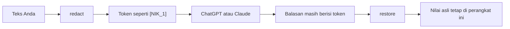

<p align="center">
  
</p>

<h1 align="center">Tirai</h1>

<p align="center">
  <strong>Tirai lokal antara teks Anda dan obrolan AI.</strong><br>
  Menyamarkan identitas Indonesia di perangkat, lalu mengembalikan nilai asli setelah balasan tiba.
</p>

<p align="center">
  <a href="README.md">English</a> ·
  Bahasa Indonesia
</p>

<p align="center">
  <a href="https://www.npmjs.com/package/@adindamochamad/tirai"></a>
  <a href="https://github.com/adindamochamad/tirai/actions/workflows/ci.yml"></a>
  <a href="LICENSE"></a>
  
</p>

> **Alat bantu, bukan jaminan.** Baca ulang teks sebelum dikirim. Tirai tidak mengenali semua cara orang menuliskan nomor, dan bisa saja menyamarkan sesuatu yang bukan data pribadi.

Tirai tidak mengirim teks keluar dari perangkat. Ada [pustaka npm](#pemasangan), [halaman demo](#demo), dan [ekstensi Chrome](#ekstensi-chrome) untuk ChatGPT dan Claude. Janji privasi: [halaman publik](https://adindamochamad.github.io/tirai/privacy.html) dan [PRIVACY.md](PRIVACY.md).



## Yang disamarkan

Aturannya ekspresi reguler ditambah beberapa pemeriksaan — bukan pembelajaran mesin. Jika aturan ambigu, teks **tanpa label** disamarkan lebih sedikit. Rincian dan kelalaian yang diketahui ada di [docs/detectors.md](docs/detectors.md).

| Jenis          | Token          | Pemicu khas                                                |
| -------------- | -------------- | ---------------------------------------------------------- |
| NIK / KTP      | `[NIK_1]`      | Nomor identitas 16 digit                                   |
| Kartu Keluarga | `[KK_1]`       | 16 digit setelah label KK                                  |
| NPWP           | `[NPWP_1]`     | Bentuk 15 digit bertitik, atau 15/16 digit berlabel        |
| Telepon        | `[TELEPON_1]`  | HP Indonesia, plus telepon rumah seperti `021-…`           |
| Plat           | `[PLAT_1]`     | Plat sipil dengan kode wilayah yang diizinkan              |
| Surel          | `[EMAIL_1]`    | `nama@domain.id`                                           |
| Paspor         | `[PASPOR_1]`   | 1 huruf + 7 digit, hanya berlabel                          |
| Rekening       | `[REKENING_1]` | 8–16 digit setelah label rekening                          |
| Kartu bank     | `[KARTU_1]`    | PAN berkelompok yang lolos Luhn, atau kartu berlabel       |
| Alamat         | `[ALAMAT_1]`   | `Jl.` / `Jalan` + nama kapital, RT/RW, atau label `alamat` |
| Nama orang     | `[NAMA_1]`     | Hanya dengan label seperti `nama pelapor` atau `a.n.`      |

Nama tanpa label tetap terlihat: **Saya Budi** tidak disamarkan. **Nama pelapor Siti Aminah** disamarkan.

## Contoh

```ts
import { redact, restore } from "@adindamochamad/tirai";

const input =
  "Saya Budi, NIK 3171010101010000, HP 0800-0000-0001, motor B 4321 XYZ ditilang.";

const { redacted, vault } = redact(input);
// Saya Budi, NIK [NIK_1], HP [TELEPON_1], motor [PLAT_1] ditilang.

const reply =
  "Terima kasih. Kami akan menghubungi [TELEPON_1] terkait kendaraan [PLAT_1].";
restore(reply, vault);
// Terima kasih. Kami akan menghubungi 0800-0000-0001 terkait kendaraan B 4321 XYZ.
```

`redact(text, options)` mengembalikan `{ redacted, vault, findings }`. `findings` berisi `type`, `token`, serta offset pada teks asli — tanpa nilai asli.

`restore(text, vault)` mengembalikan token yang dikenal. `[ telepon_1 ]` diterima. Token yang tidak dikenal dibiarkan.

Lewatkan `options.vault` agar kode yang sama dipakai pada beberapa tempelan. `options.detectors` membatasi deteksi ke jenis di `PII_TYPES`. `options.nikStrict` bawaan `true`; isi `false` untuk menyamarkan setiap deretan 16 digit tanpa label (yang diawali `0` tetap bukan NIK).

<p align="center">
  
</p>

<p align="center"><sub>Contoh sintetis. Bukan data orang sungguhan. Ekstensi memperingatkan sekali jika editor masih berisi nilai mentah.</sub></p>

## Pemasangan

```bash
npm install @adindamochamad/tirai
```

Nama tanpa scope `tirai` tidak tersedia. Paket ini **tidak punya dependensi runtime**.

## CLI dan MCP lokal

Untuk OpenCode, Cursor, Claude Code, dan alat serupa. Pustaka yang sama, proses lokal, tanpa peladen. Jangan kirim keluaran `restore` ke model jarak jauh.

```bash
echo "SINTETIS. NIK 3171010101010000, HP 0800-0000-0001." | npx @adindamochamad/tirai redact --json
npx @adindamochamad/tirai mcp
```

OpenCode (`opencode.json`):

```json
{
  "mcp": {
    "tirai": {
      "type": "local",
      "command": ["npx", "-y", "@adindamochamad/tirai", "mcp"]
    }
  }
}
```

Opsi, berkas vault, dan klien lain ada di [docs/cli.md](docs/cli.md).

Dari repositori ini:

```bash
npm ci
npm test
npm run dev
```

## Privasi

Ini bukan peladen, akun, atau basis data. Pustaka, demo, dan ekstensi tidak mengirim teks ke mana pun.

- Vault hanya hidup di memori selama objek itu Anda simpan. **Hapus semua** di demo mengosongkannya. Proses MCP menyimpannya di RAM sampai proses berhenti. `--vault FILE` menulis cuplikan lokal hanya jika Anda minta. Tidak ditulis ke `localStorage`, `sessionStorage`, IndexedDB, cookie, atau URL.
- `JSON.stringify(vault)`, `String(vault)`, dan inspect Node mengembalikan `[Vault: N entries]`. Isinya tidak memuat nilai yang disimpan.
- Pustaka tidak mencatat teks masukan, temuan, atau isi vault.
- Demo tidak memanggil `fetch`, `XMLHttpRequest`, `WebSocket`, atau `sendBeacon`. **Kirim ke AI (simulasi)** adalah fungsi lokal. Jika Anda memakai alat obrolan sungguhan, Anda sendiri yang menyalin teks tersamar.
- CSP demo: `default-src 'self'; connect-src 'none'; script-src 'self'; style-src 'self'`.

Kebijakan privasi publik: [https://adindamochamad.github.io/tirai/privacy.html](https://adindamochamad.github.io/tirai/privacy.html). Teks yang sama ada di [PRIVACY.md](PRIVACY.md).

Repositori ini tidak menerbitkan angka ketepatan. Pengujian hanya menggambarkan perilaku pada contoh sintetis.

## Ekstensi Chrome

Tempel di [chatgpt.com](https://chatgpt.com) atau [claude.ai](https://claude.ai) dan Tirai mengganti identitas dengan token. Nilai asli tetap di **memori tab itu**. Jika editor masih berisi nilai mentah, peringatan sekali menawarkan **Samarakan** atau **Kirim apa adanya**. Tirai tidak mengirim pesan untuk Anda.

Belum ada cantuman di Chrome Web Store.

```bash
npm run build:ext
```

Di Chrome: `chrome://extensions` → mode pengembang → **Load unpacked** → `extension/dist`. Pemilih, cara sisip, dan teks toko ada di [docs/extension.md](docs/extension.md).

<p align="center">
  
</p>

## Demo

Demo daring (GitHub Pages): [https://adindamochamad.github.io/tirai/](https://adindamochamad.github.io/tirai/). Halaman privasi: [https://adindamochamad.github.io/tirai/privacy.html](https://adindamochamad.github.io/tirai/privacy.html).

```bash
npm run dev          # halaman lokal
npm run build:demo   # berkas statis di dist-demo/
```

Muat ulang langsung pada server pengembangan ingin membuka soket, dan CSP di atas melarangnya. Pakai halaman **hasil bangun** bila Anda ingin log jaringan kosong.

1. Tempel contoh Budi → **Samarakan**. Token muncul; tabel di layar ini menampilkan nilai asli.
2. **Kirim ke AI (simulasi)** — lokal; catatannya mengatakan itu.
3. **Kembalikan** — **Hasil akhir** menampilkan telepon dan plat lagi.
4. **Hapus semua** mengosongkan isian dan tabel.
5. DevTools → Network: muat ulang halaman hasil bangun, tempel lagi, pastikan log tetap kosong.

## Yang bukan cakupan

- Bukan daftar lengkap data pribadi Indonesia.
- Bukan vault tersimpan, ekspor terenkripsi, atau detektor ML.
- Bukan klaim bahwa setiap NIK, kartu, atau alamat akan ketemu.

## Dokumen

- [Aturan detektor](docs/detectors.md)
- [CLI dan MCP lokal](docs/cli.md)
- [Ekstensi Chrome](docs/extension.md)
- [Teks cantuman toko](docs/store-listing.md)
- [Privasi (publik)](https://adindamochamad.github.io/tirai/privacy.html)
- [Sumber privasi](PRIVACY.md)
- [Changelog](CHANGELOG.md)

## Ilham

Tirai terilham dari [Rampart](https://github.com/nationaldesignstudio/rampart). Kode Rampart tidak dipakai di sini, dan API-nya tidak sama.

## Lisensi

MIT. Hak cipta (c) 2026 Adinda Panca Mochamad.
