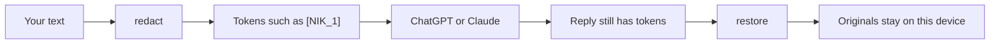
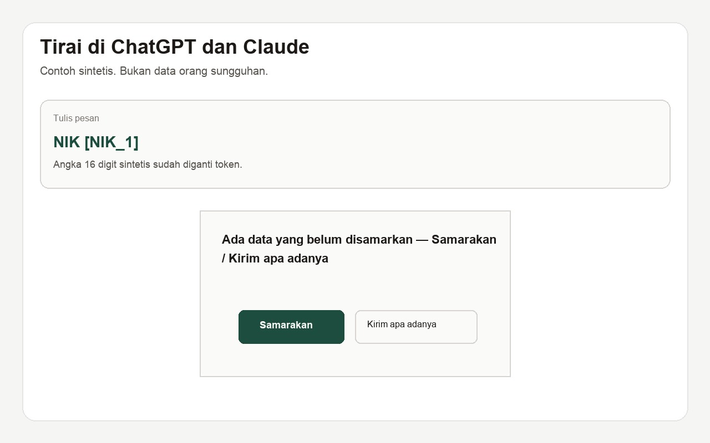
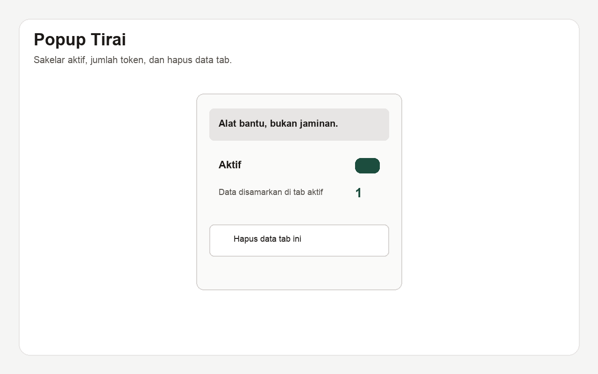

<p align="center">
  
</p>

<h1 align="center">Tirai</h1>

<p align="center">
  <strong>A local curtain between your text and an AI chat.</strong><br>
  Masks Indonesian identifiers on the device, then puts the originals back after the reply.
</p>

<p align="center">
  English ·
  <a href="README.id.md">Bahasa Indonesia</a>
</p>

<p align="center">
  <a href="https://www.npmjs.com/package/@adindamochamad/tirai"></a>
  <a href="https://github.com/adindamochamad/tirai/actions/workflows/ci.yml"></a>
  <a href="LICENSE"></a>
  
</p>

> **A helper, not a guarantee.** Read the text again before you send it. Tirai does not know every way a person can write a number, and it can mask something that is not personal data.

Tirai never sends your text off the device. There is an [npm library](#install), a [static demo](#demo), and a [Chrome extension](#chrome-extension) for ChatGPT and Claude. Privacy promises: [public page](https://adindamochamad.github.io/tirai/privacy.html) and [PRIVACY.md](PRIVACY.md).



## What it masks

Rules are regular expressions plus a few checks — not machine learning. When a rule is ambiguous, unlabeled text is masked **less**. Details and known misses are in [docs/detectors.md](docs/detectors.md).

| Kind           | Token          | Typical trigger                                                   |
| -------------- | -------------- | ----------------------------------------------------------------- |
| NIK / KTP      | `[NIK_1]`      | 16-digit identity number                                          |
| Kartu Keluarga | `[KK_1]`       | 16 digits after a KK label                                        |
| NPWP           | `[NPWP_1]`     | Dotted 15-digit form, or a labeled 15/16-digit run                |
| Phone          | `[TELEPON_1]`  | Indonesian mobile, plus landlines such as `021-…`                 |
| Vehicle plate  | `[PLAT_1]`     | Civilian plate with an allowlisted region code                    |
| Email          | `[EMAIL_1]`    | `nama@domain.id`                                                  |
| Passport       | `[PASPOR_1]`   | One letter + seven digits, labeled only                           |
| Bank account   | `[REKENING_1]` | 8–16 digits after a rekening label                                |
| Payment card   | `[KARTU_1]`    | Grouped PAN that passes Luhn, or a labeled card                   |
| Address        | `[ALAMAT_1]`   | `Jl.` / `Jalan` + a capitalised name, RT/RW, or an `alamat` label |
| Personal name  | `[NAMA_1]`     | Only with a label such as `nama pelapor` or `a.n.`                |

Unlabeled names in prose stay visible: **Saya Budi** is not masked. **Nama pelapor Siti Aminah** is.

## Example

```ts
import { redact, restore } from "@adindamochamad/tirai";

const input =
  "Saya Budi, NIK 3171010101010000, HP 0800-0000-0001, motor B 4321 XYZ ditilang.";

const { redacted, vault } = redact(input);
// Saya Budi, NIK [NIK_1], HP [TELEPON_1], motor [PLAT_1] ditilang.

const reply =
  "Terima kasih. Kami akan menghubungi [TELEPON_1] terkait kendaraan [PLAT_1].";
restore(reply, vault);
// Terima kasih. Kami akan menghubungi 0800-0000-0001 terkait kendaraan B 4321 XYZ.
```

`redact(text, options)` returns `{ redacted, vault, findings }`. Findings include `type`, `token`, and offsets into the original text — not the original value.

`restore(text, vault)` replaces known tokens. `[ telepon_1 ]` is accepted. Unknown tokens stay as they are.

Pass `options.vault` so the same codes survive several pastes. `options.detectors` limits the run to types in `PII_TYPES`. `options.nikStrict` defaults to `true`; set it to `false` to mask every unlabeled 16-digit run (a run that starts with `0` is still not a NIK).

<p align="center">
  
</p>

<p align="center"><sub>Synthetic example. Not a real person’s data. The extension warns once if the editor still holds raw identifiers.</sub></p>

## Install

```bash
npm install @adindamochamad/tirai
```

The unscoped name `tirai` is not available. The package has **no runtime dependencies**.

## CLI and local MCP

For OpenCode, Cursor, Claude Code, and similar tools. Same library, local process, no server. Do not send `restore` output to a remote model.

```bash
echo "SINTETIS. NIK 3171010101010000, HP 0800-0000-0001." | npx @adindamochamad/tirai redact --json
npx @adindamochamad/tirai mcp
```

OpenCode (`opencode.json`):

```json
{
  "mcp": {
    "tirai": {
      "type": "local",
      "command": ["npx", "-y", "@adindamochamad/tirai", "mcp"]
    }
  }
}
```

Flags, vault files, and other clients are in [docs/cli.md](docs/cli.md).

From this repository:

```bash
npm ci
npm test
npm run dev
```

## Privacy

Nothing here is a server, an account, or a database. The library, the demo, and the extension do not send your text anywhere.

- The vault lives in memory for as long as you keep the object. The demo’s **Hapus semua** clears it. The MCP process keeps it in RAM until the process exits. `--vault FILE` writes a local snapshot only if you ask. It is not written to `localStorage`, `sessionStorage`, IndexedDB, cookies, or the URL.
- `JSON.stringify(vault)`, `String(vault)`, and Node’s inspect hook return `[Vault: N entries]`. They do not contain the stored values.
- The library does not log input text, matches, or vault contents.
- The demo does not call `fetch`, `XMLHttpRequest`, `WebSocket`, or `sendBeacon`. **Kirim ke AI (simulasi)** is a local function. You copy the masked text yourself if you use a real chat tool.
- Demo CSP: `default-src 'self'; connect-src 'none'; script-src 'self'; style-src 'self'`.

The public privacy policy is [https://adindamochamad.github.io/tirai/privacy.html](https://adindamochamad.github.io/tirai/privacy.html). The same text lives in [PRIVACY.md](PRIVACY.md).

This repository does not publish accuracy, precision, or recall figures. Tests describe behavior on synthetic examples only.

## Chrome extension

Paste into [chatgpt.com](https://chatgpt.com) or [claude.ai](https://claude.ai) and Tirai replaces identifiers with tokens. Originals stay in **that tab’s memory**. If the editor still holds raw values, a one-time warning offers **Samarakan** or **Kirim apa adanya**. Tirai does not send the message for you.

There is no Chrome Web Store listing yet.

```bash
npm run build:ext
```

In Chrome: `chrome://extensions` → Developer mode → **Load unpacked** → `extension/dist`. Selectors, insert methods, and store copy are in [docs/extension.md](docs/extension.md).

<p align="center">
  
</p>

## Demo

Live demo (GitHub Pages): [https://adindamochamad.github.io/tirai/](https://adindamochamad.github.io/tirai/). Privacy page: [https://adindamochamad.github.io/tirai/privacy.html](https://adindamochamad.github.io/tirai/privacy.html).

```bash
npm run dev          # local page
npm run build:demo   # static files in dist-demo/
```

The dev server’s live reload wants a network socket, which the demo CSP forbids. Use the **built** page when you want an empty network log.

1. Paste the Budi example → **Samarakan**. Tokens appear; the table on this screen shows the originals.
2. **Kirim ke AI (simulasi)** — local only; the note says so.
3. **Kembalikan** — **Hasil akhir** shows the phone and plate again.
4. **Hapus semua** clears the fields and the table.
5. DevTools → Network: reload the built page, paste again, confirm the log stays empty.

## What it is not

- Not a complete list of Indonesian personal data.
- Not a saved vault, encrypted export, or ML detector.
- Not a claim that every NIK, card, or address will be found.

## Docs

- [Detector rules](docs/detectors.md)
- [CLI and local MCP](docs/cli.md)
- [Chrome extension](docs/extension.md)
- [Store listing copy](docs/store-listing.md)
- [Privacy (public)](https://adindamochamad.github.io/tirai/privacy.html)
- [Privacy source](PRIVACY.md)
- [Changelog](CHANGELOG.md)

## Inspiration

Tirai is inspired by [Rampart](https://github.com/nationaldesignstudio/rampart). It does not share Rampart’s code, and it is not API-compatible with Rampart.

## License

MIT. Copyright (c) 2026 Adinda Panca Mochamad.
